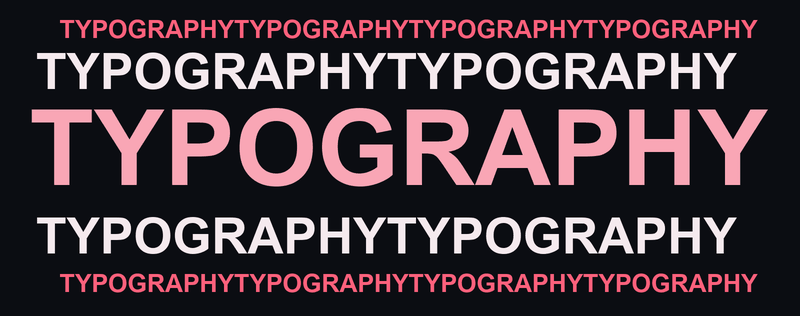

# Typographic Repetition Poster

A Python CLI tool that generates Swiss-style typographic repetition posters as high-resolution static PNGs or sleek animated GIFs using Pillow.

Each row repeats your phrase according to a pattern (like `42124`) and binary-searches the exact font size so every row spans the full poster width.



## Installation

```bash
pip install -r requirements.txt
```

## Usage

### Static PNG Poster

```bash
python3 poster.py "TYPOGRAPHY" --reps 42124 --upper --tight --colors alternate
```

### Animated GIF Poster

```bash
python3 poster.py "TYPOGRAPHY" \
  --reps 42124 \
  --upper \
  --tight \
  --animate \
  --anim-style kinetic \
  --ink-color "#F4F5F7" \
  --accent "#FF3B5C" \
  --paper "#0B0D12" \
  --frames 48 \
  --fps 24 \
  --out examples/kinetic-preview.gif
```

## Options

| Flag | Default | Description |
| :--- | :--- | :--- |
| `word` | *(required)* | Word or phrase to repeat |
| `--reps` | `42124` | Row repetition pattern (e.g. `42124` or `4,2,1,2,4`) |
| `--font` | `sans` | Font style: `sans`, `serif`, or `mono` |
| `--font-path` | `""` | Custom path to a `.ttf`, `.ttc`, or `.otf` font file |
| `--upper` | `false` | Convert phrase to uppercase |
| `--sep` | `""` | Separator between repeated words |
| `--width` | `800` | Poster width in px |
| `--pad` | `40` | Horizontal padding in px |
| `--gap` | `10.0` | Vertical gap between rows in px |
| `--scale` | `2` | Render scale multiplier (supersampled for crisp GIFs) |
| `--tight` | `false` | Use tight bounding box height |
| `--colors` | `solid` | Color mode: `solid`, `alternate`, or `rainbow` |
| `--ink-color` | `#111111` | Primary text hex color |
| `--accent` | `#e63946` | Accent hex color |
| `--paper` | `#f8f9fa` | Background hex color |
| `--animate` | `false` | Export an animated GIF instead of a static PNG |
| `--anim-style` | `kinetic` | Animation style: `kinetic`, `wave`, `pulse`, `rainbow-shift`, `cascade` |
| `--frames` | `48` | Number of frames for animated GIF |
| `--fps` | `24` | Frames per second for animated GIF |
| `--out` | `""` | Custom output file path |
